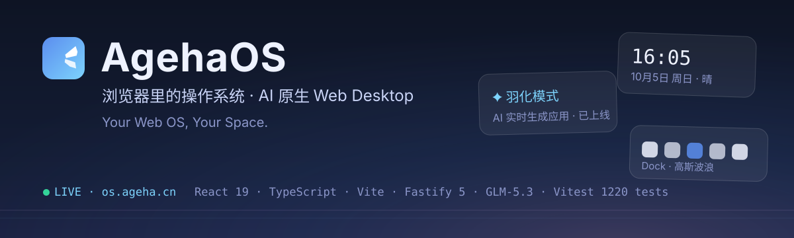
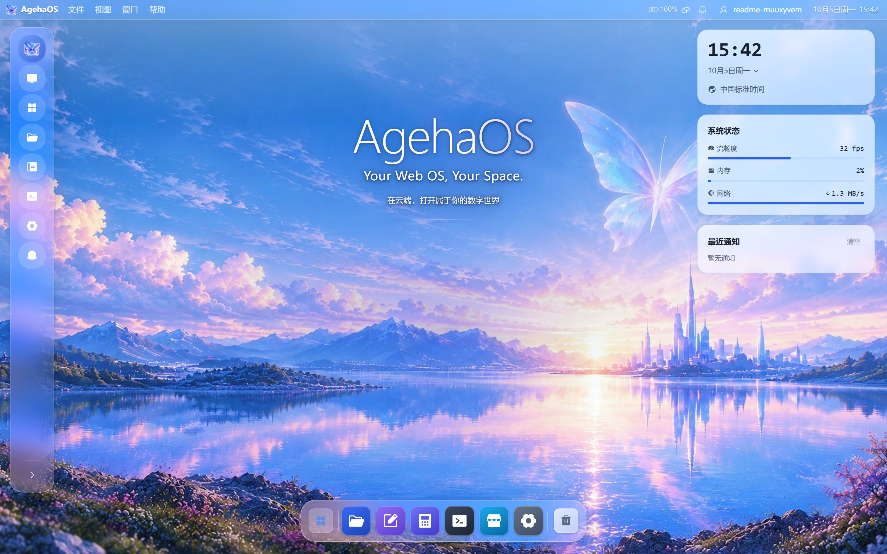
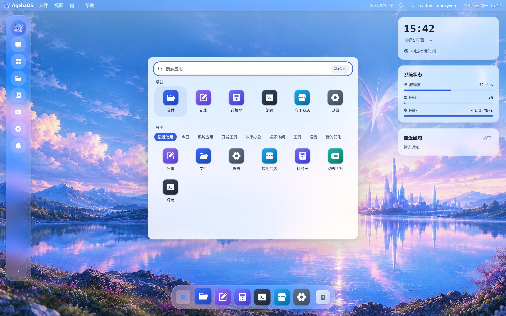
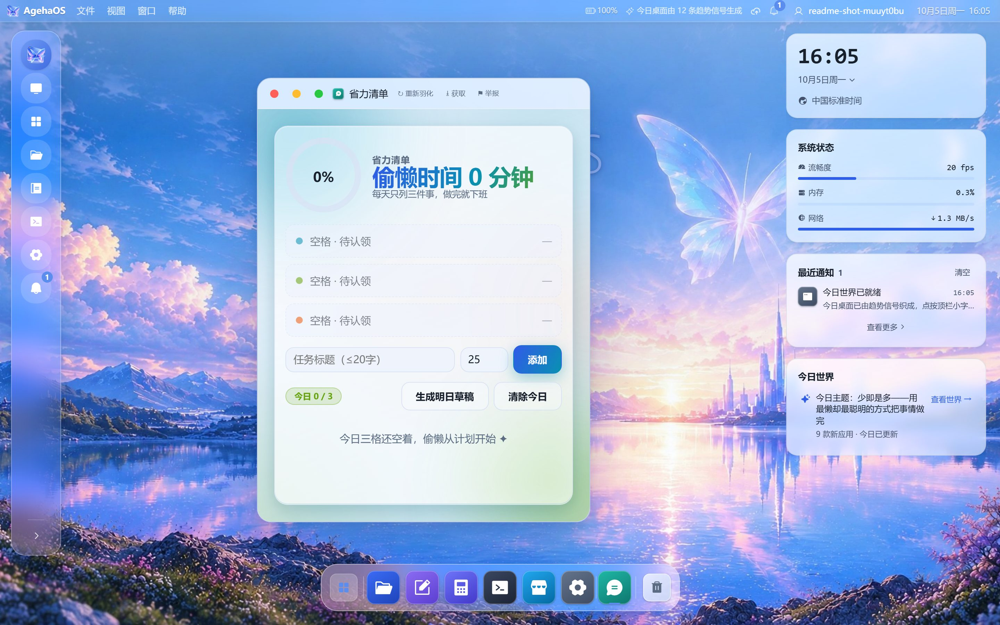
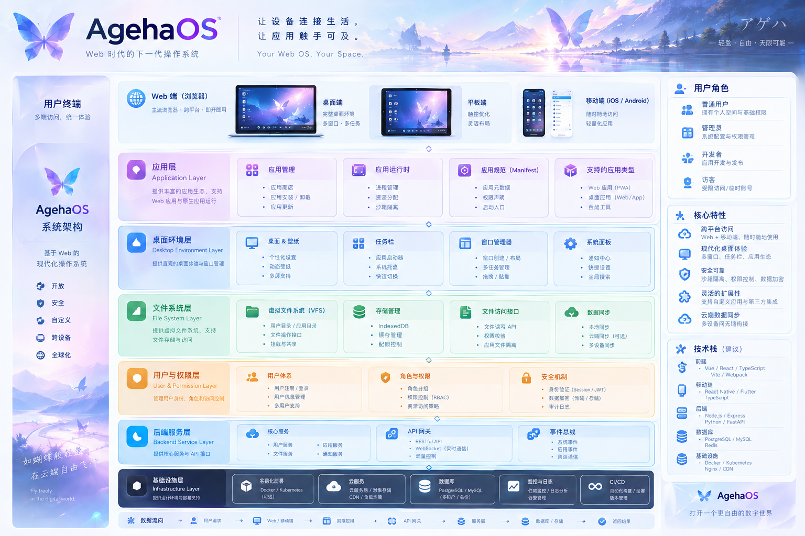

<p align="center">
  
</p>

# AgehaOS 🦋

**Your Web OS, Your Space.** —— 在云端，打开属于你的数字世界。

AgehaOS 是一个运行在现代浏览器中的「操作系统式 Web OS」：**桌面与手机是同一套 OS Core 的两个 Shell**——桌面是 Workspace Environment（窗口管理器 + 漂浮岛布局），手机与平板打开同一网址即是独立设计的 Mobile Shell（safe-area 骨架 + 全屏应用 + 手势导航），并已上生产双端可用。其上运行窗口管理器、应用运行时、虚拟文件系统、用户与权限体系，外加一条操作系统级的 AI 能力线——**AI 动态桌面**与**羽化实时生成应用**。

核心理念：**Everything is an App, Everything is a File, Everything is Web.**

**[🌐 立即体验 os.ageha.cn](https://os.ageha.cn)** · [产品需求文档](docs/PRD.md) · [设计契约](docs/DESIGN.md) · [更新日志](CHANGELOG.md)

## 桌面一览 —— Desktop Shell 3.0 · Workspace Environment

<p align="center">
  
</p>

- **左侧 Workspace Rail**：hover / click / 键盘展开 Workspace Panel——品牌区、今日空间、工作空间选择器、最近使用、今日世界入口
- **右侧 System Center**：时钟、系统状态、最近通知、今日世界，独立漂浮不锁高度
- **中央品牌层**：随桌面状态四档弱化——打开窗口即让位给内容
- **Dock**：高斯波浪跟随指针；居中 Application Launcher、运行应用、回收站

## 应用生态

<table>
  <tr>
    <td width="50%"></td>
    <td width="50%"></td>
  </tr>
  <tr>
    <td align="center"><sub><b>Application Launcher</b> —— Spotlight 式搜索、最近使用、常驻与分类</sub></td>
    <td align="center"><sub><b>羽化生成的应用</b> —— 输入想法，即时羽化出一个可用的应用</sub></td>
  </tr>
</table>

## 四条产品线

### 🖥 Desktop Shell 3.0 · Workspace Environment

窗口管理器（拖拽/缩放/焦点档/Genie/幽灵关闭）、虚拟文件系统 + 文件管理器、App Store 与沙箱应用运行时（Type B iframe + Type C SDK）、通知中心、Ctrl+K 全局搜索（应用 / 文件 / 动作三域）、终端与计算器等系统应用。

**Window Management 2.0 + Ageha Spaces**（多桌面与窗口调度）：

- **多桌面（Space）**：F4 打开 Mission Control——新建 / 重命名 / 删除 Space，把窗口卡片拖到另一枚 Space 胶囊即跨桌面移动（应用不重启）；Ctrl+Alt+←/→ 快速切换，切换不销毁窗口，回来还是原样
- **窗口贴靠（Snap）**：拖窗口到屏幕左/右缘出现半屏预览，松手像素级精确吸附；拖到顶缘即最大化；刷新页面后窗口位置、大小与所在桌面原样恢复
- **Alt+W 窗口切换器**：按住出面板按层级循环选择、松开切换，轻点直接轮转焦点
- **Dock 空间感知**：其他 Space 里运行的应用在 Dock 显示小圆点与「在其他空间」标注，点击直达所在桌面；左侧 Workspace selector 四档与 Space 联动绑定，圆点指示当前档

视觉契约见 [docs/DESIGN.md](docs/DESIGN.md) §17-§34、§36-§37。

### 🌅 AI 动态桌面

生成式壁纸引擎（程序山水 → 真实风景照）、梯度场可选覆盖层、桌面编排建议（LLM 同源代理 + 词表门控 + 三级降级）、内容面板按情境推荐。设计见 [docs/AI-DYNAMIC-DESKTOP-DESIGN.md](docs/AI-DYNAMIC-DESKTOP-DESIGN.md)。

### ✨ 羽化模式 · AI 实时生成应用

操作系统级的 AI 生成：**基础软件 AI 化**（计算器/记事本/时钟现场生成，原生实现兜底）、**今日世界**（每日依据 GitHub Trending 织出主题与一批今日应用，跨日换新）、**想象搜索**（Ctrl+K 输入任何想法，即时羽化出一个可用的应用）、**治理与蝶谱**（举报链路、admin 复审、历史回放）。安全底座：不透明 origin 沙箱 + 禁网 CSP + JS 语法闸 + Default Deny 权限（L2/L3 仅开放命名空间隔离的 storage），生成应用数据跨重开持久化。设计见 [docs/AI-GENERATED-APPS-DESIGN.md](docs/AI-GENERATED-APPS-DESIGN.md)。

### 📱 Mobile Web / Mobile Shell

同一套 OS Core 的移动形态：手机与平板打开 os.ageha.cn（或安装为 PWA）时渲染独立的 **MobileShell**，桌面照旧渲染 Desktop Shell。**双 Shell、同一 Core**：窗口管理器、VFS、权限、应用注册表、i18n 与启动门禁（`launchApp`）完全共享，只有容器层分壳；设备判定集中在 core 纯 TS 探针，`App.tsx` ready 分支单点切换（[docs/ARCHITECTURE.md](docs/ARCHITECTURE.md) §3.25）。架构分五期落地，已全部上生产：

- **Shell 地基**：safe-area 三段骨架（状态栏 / 内容滚动区 / Dock）、竖屏壁纸构图、PWA 地基（manifest + standalone + `viewport-fit=cover` + iOS meta；安装条走真实 `beforeinstallprompt`，iOS 给「添加到主屏幕」指引）、真实能力状态栏（时钟/电量/网络/用户，**能力不可用整项隐藏，绝不显示示例数据**）
- **Home Shell**：品牌问候与时段问候、今日世界卡（羽化世界摘要，无数据整卡隐藏）、最近使用（usage-store 最新 4 条）、应用网格（全量已安装应用 4 列）、Dock（Home 复位 + Files/Notes/今日世界/Settings 固定 5 位）、全屏应用视图（显式全屏几何开窗，浏览器返回键回 Home 不退出站点，离开视图即关窗）
- **系统面**：应用抽屉启动器（Bottom Sheet + 实时搜索）、通知中心（与桌面共享同一 notification-store，桌面零改动）、控制中心（主题/字号/语言/减弱动效/登出，全部改既有 store 即全局生效的真实开关）
- **手势与多任务**：左缘滑入返回、Dock 底缘上滑唤起启动器、最近任务切换器（Dock Home 位长按打开卡片轨道，切回已开应用不重启、上滑关单应用）、Files 长按操作单（动作与桌面右键同一条代码路径）
- **信息面与性能预算**：全域搜索（启动器升「应用 + 文件」双域，点击文件定位到所在目录）、通知点击跳转（崩溃/羽化失败通知直达应用）、云同步状态面（Settings「同步」分区如实展示和解结果与降级）、Terminal 快捷键行（Esc/Tab/Ctrl+C/↑/↓ 真实触控键）、玻璃白名单源文本钉扎 + 冷加载性能探针门禁

七个内置应用全部完成 560px 窄容器适配（桌面宽容器行为零变化）。视觉契约见 [docs/DESIGN.md](docs/DESIGN.md) §35（§35.8-§35.10），真机验收清单见 [docs/MOBILE-QA-CHECKLIST.md](docs/MOBILE-QA-CHECKLIST.md)。

## 快速开始

要求 Node.js ≥ 20.19（推荐 24 LTS）。

```bash
npm install       # 安装依赖
npm run dev       # 启动开发服务器
npm run test      # 运行单元测试
npm run test:e2e  # 构建并运行 Playwright E2E 测试
npm run lint      # ESLint 检查
npm run typecheck # TypeScript 检查
npm run build     # 生产构建（含 typecheck）
```

E2E 首次运行前需安装浏览器：`npx playwright install chromium`。

羽化模式的本地联调需后端 LLM 上游（OpenAI 兼容协议，`AGEHA_ECLOSION_API_KEY / BASE_URL / MODEL`）：`npm run dev:server` + `VITE_AUTH_BACKEND=api npm run dev`，完整环境变量与端点见 [docs/API.md](docs/API.md)。

## 架构

<p align="center">
  
</p>

| 层     | 选型                                                     |
| ------ | -------------------------------------------------------- |
| 前端   | React 19 · TypeScript · Vite · Zustand · Tailwind CSS 4  |
| 测试   | Vitest · Testing Library · jsdom · Playwright（E2E）     |
| 后端   | Node.js 24 · Fastify 5 · pg（PostgreSQL，驱动就绪）· tsx |
| AI     | OpenAI 兼容上游 · SSE 流式 · 结构闸与自动重试             |

<details>
<summary><b>目录结构</b>（展开）</summary>

```text
src/
├── core/            # OS Core Runtime（框架无关，禁止依赖 React）
│   ├── events/      # 事件总线 + 系统事件映射
│   ├── i18n/        # 国际化（zh-CN / en）
│   ├── window/      # 窗口管理器（生命周期/焦点/z序/几何约束/空间）
│   ├── runtime/     # Manifest 校验 + AppRegistry + 生命周期跟踪
│   ├── filesystem/  # VFS（文件树/CRUD/回收站/搜索 + IndexedDB 适配器）
│   ├── permissions/ # 权限系统（Default Deny + 持久化）
│   ├── platform/    # 设备能力探针（Desktop / Tablet / Mobile 判定，纯 TS）
│   ├── dynamic/     # AI 动态桌面纯引擎（决策/质量门/生成器）
│   └── eclosion/    # 羽化模式纯模块（规格表/世界校验/SSE/HTML 切分/运行时协议）
├── desktop/         # 桌面环境 UI（Desktop Shell 3.0）
│   ├── sidebar/     # 左侧 Workspace Rail + 可展开 Workspace Panel
│   ├── widgets/     # 右侧漂浮 System Center
│   ├── branding/    # 中央品牌层（四档 opacity）
│   ├── taskbar/     # 底部 Dock（启动器、运行窗口、通知中心、悬停预览）
│   ├── search/      # Ctrl+K 全局搜索（Apps / Files / Actions）
│   └── …            # boot / window / menu-bar / notification / wallpaper / workspace
├── mobile/          # 移动 Shell（MobileShell 根 + home / statusbar / dock / launcher /
│   │                #   recents / notifications / controlcenter / app / gesture / pwa）
├── apps/            # 系统应用（files / notes / settings / calculator / terminal …）
├── sdk/             # AgehaOS App SDK
├── store/ services/ components/
└── main.tsx
server/              # Fastify 5 后端（认证 / AI 代理 / 羽化编排 / 同步 / 签名目录）
```

</details>

## 测试与质量基线

**~1920 前端单测（Vitest，180 文件）+ 后端测试 + 部署库测试 + Playwright E2E 全域（49 spec，含移动 context 全链路）**，四道门禁（`typecheck / lint / test / test:e2e`）全绿才交付；CI 对 push/PR 跑同一门禁。协作与质量约定见 [docs/CONTRIBUTING.md](docs/CONTRIBUTING.md)。

## 文档

| 文档 | 内容 |
| --- | --- |
| [docs/PRD.md](docs/PRD.md) | 产品需求文档（51 节） |
| [docs/ARCHITECTURE.md](docs/ARCHITECTURE.md) | 技术架构与 ADR |
| [docs/DESIGN.md](docs/DESIGN.md) | 视觉契约（Token / 材质 / Shell 3.0 结构） |
| [docs/AI-GENERATED-APPS-DESIGN.md](docs/AI-GENERATED-APPS-DESIGN.md) | 羽化模式设计（生成 / 沙箱 / 治理） |
| [docs/AI-DYNAMIC-DESKTOP-DESIGN.md](docs/AI-DYNAMIC-DESKTOP-DESIGN.md) | AI 动态桌面设计 |
| [docs/API.md](docs/API.md) | 后端契约与环境变量 |
| [docs/SECURITY.md](docs/SECURITY.md) | 安全设计（沙箱 / CSP / 认证） |
| [docs/MOBILE-QA-CHECKLIST.md](docs/MOBILE-QA-CHECKLIST.md) | 移动端真机验收清单（iOS Safari / Android Chrome） |
| [CHANGELOG.md](CHANGELOG.md) | 更新日志 |
