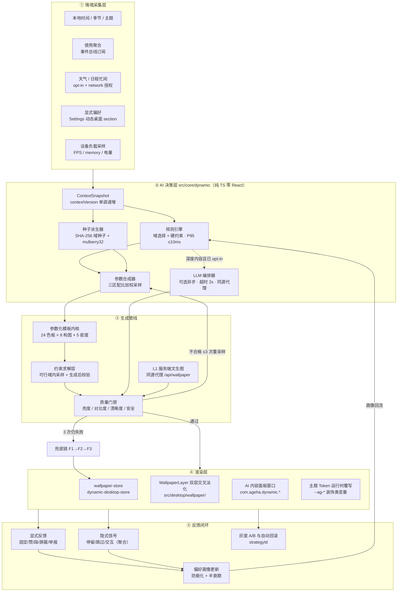
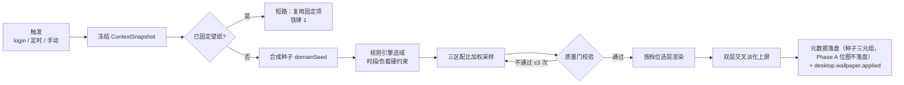
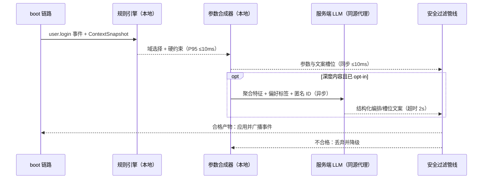
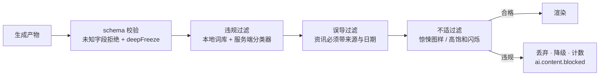
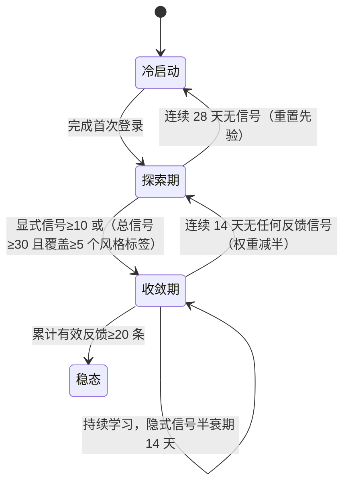

# AgehaOS AI 动态桌面系统设计方案

| 项 | 内容 |
| --- | --- |
| 文档状态 | 设计提案（四份章节草稿整合稿，待评审） |
| 版本 / 日期 | v1.0 / 2026-09-22 |
| 基线 | AgehaOS v0.1.0（PRD §51 全部 15 步已完成） |
| 关联文档 | `docs/PRD.md`（§9 Manifest、§10 权限、§22 事件、§27 主题、§29 性能、§30 安全、§35 版本规划）、`docs/ARCHITECTURE.md`、`docs/SECURITY.md` |
| 一句话目标 | **随机但不失控、新鲜但不混乱**：每次进入系统获得一张新鲜且贴合偏好的动态壁纸与可选内容面板，任何情况下桌面都有可用壁纸、任何情况下不拖慢系统、任何情况下核心应用稳定如常 |

本文档整合壁纸实时生成、软件内容智能决策、随机性控制治理、体验优化闭环四份设计草稿，消除重复与口径冲突（差异裁决见 §12.2），形成可直接指导开发的统一方案。

---

## 1. 概述与设计原则

### 1.1 目标与范围

AI 动态桌面是 AgehaOS 的新方向，**不在 PRD §35 既有版本规划内**（§35 Phase 2/v0.2 规划为 App Store、Terminal、通知中心、搜索）。本设计界定它的能力边界：

- **做什么**：① 动态壁纸——登录时、定时或手动触发的种子化程序化生成与服务端文生图；② 主题微调——在设计 Token 允许范围内运行时覆写装饰类变量；③ AI 内容面板——以独立窗口呈现的资讯摘要、任务建议等卡片；④ 桌面编排**建议**——应用分组与窗口布局建议（仅建议，可一键采纳或忽略）。
- **不做什么**：不替代任何核心应用（见 §5.2 永不随机清单）、不自由生成 UI 结构、不在未授权下采集任何网络情境、不让随机内容触碰用户数据。

### 1.2 十二条产品铁律落点总表

| # | 铁律 | 本方案落点 |
| --- | --- | --- |
| 1 | 用户中心优先，保留手动固定 | 固定/收藏优先级最高：固定即短路整条生成链（ε=0），仅可手动解除（§6.3、§6.5） |
| 2 | 质量底线，杜绝模糊错乱违和 | 三道质量闸门（schema 白名单 → 硬约束 → 质量门），最多 3 次重采样，仍失败逐级兜底（§4.4、§6.2、§9） |
| 3 | 惊喜与熟悉并存 | 稳定锚点（偏好色相锁定、品牌主色 ±30° 邻域）+ 三区配比 70/20/10 + ε 探索（§6.3） |
| 4 | 透明可控 | 「由 AI 生成」徽标、结构化生成理由、五级随机度滑杆、决策日志、历史回滚（§6.5） |
| 5 | 情境驱动 | 信号白名单：时间/季节/主题/使用聚合/负载默认开启，天气/日程 opt-in（§2.1） |
| 6 | 渐进式个性化 | 冷启动 → 探索 → 收敛状态机，ε 阶梯 0.5→0.4→0.15→0.10（§10.2、§10.3） |
| 7 | 内容安全 | 渲染前同步过滤管线；L1 提示词仅白名单词汇表拼装；LLM 自由文本阶段门控（§8.4） |
| 8 | 资源感知调度 | FPS/内存/电池阈值触发降层与轻量模式，隐藏页暂停一切动画（§7.3） |
| 9 | 性能量化 | §7 预算总表，全部指标可测、可断言、可回归 |
| 10 | 隐私最小化 | 信号白名单 + 本地优先 + 聚合计数 + 分级保留期限，敏感信息引擎代码层面不可达（§8.5） |
| 11 | 核心应用稳定可预期 | 永不随机清单硬编码于决策器；AI 产出仅壁纸层、Token 层、显式标注窗口三个落点（§5.2） |
| 12 | 界定更新时机与频率 | 壁纸与内容面板频率表分离，全屏/专注冻结一切更新（§4.6、§5.5） |

### 1.3 五条架构原则

1. **随机但不失控**：一切随机源自显式种子，产物必须落在人工审校的模板参数空间内，任何输出先过门禁再上屏。
2. **本地优先、渐进增强**：Phase A 纯离线完整可用、默认零网络请求；联网 LLM/文生图只是叠加层，断网自动无缝回退。
3. **复用既有骨架，不开旁路**：生成内核入 `src/core/`（纯 TS、零 React），UI 入 `src/desktop/`，状态入 `src/store/`，依赖方向严格 UI → store → core（`docs/ARCHITECTURE.md:23-32`）；权限走 Default Deny（`src/core/permissions/constants.ts:2-10`）；应用注册走 `parseManifest` + `deepFreeze` 合规通道（`src/core/runtime/manifest.ts:52-123,210-216`）。
4. **透明可控**：AI 参与的每一处都可解释、可关闭、可回滚；总开关关闭后桌面行为与 v0.1.0 完全一致。
5. **稳定优先于新鲜**：每一环失败都有确定性回退，任何故障不得阻塞 boot、不得侵入首屏 ≤3s 预算（PRD §29）、不得外溢为 UI 崩溃。

---

## 2. 情境建模与用户画像

### 2.1 情境信号白名单

最小化采集：默认只启用本地信号；一切涉网络信号必须用户显式开启并逐项授权。**永不进入生成决策**（引擎代码层面不可访问，而非承诺不用）：VFS 文件内容（Notes 正文、文件字节）、凭据与密码材料（仅存在于 `core/auth`）、剪贴板、窗口标题与输入内容、GPS 精确定位、原始行为日志。

| 信号 | 形态 | 采集方式 | 存储 | 默认 | 用途 |
| --- | --- | --- | --- | --- | --- |
| 本地时间/日期/季节 | 晨/昼/暮/夜四相 + 季节枚举 | 本地时钟派生 | 不落盘，会话内计算 | 开 | 明暗基调（权重 0.4）、时段化色板 |
| 主题模式 | light/dark | 读 `useSettingsStore` | 不落盘 | 开 | 调色板过滤（权重 0.25） |
| 显式偏好 | 偏好标签向量、随机度、固定/屏蔽/收藏列表 | Settings「动态桌面」section | `agehaos.dynamic-desktop.v1.<userId>` | 开 | 决策最高优先级输入 |
| 历史行为 | 收藏/屏蔽/停留/换新聚合计数（仅「标签×模板×计数」三元组） | 事件总线订阅 | VFS `/System/ai/feedback.v1.json` ≤64KB | 开 | 偏好画像收敛 |
| 使用聚合 | 「应用×时段·启动计数」 | 订阅 `window.created/closed`、`app.started/stopped`（`src/core/events/types.ts:2-12`） | VFS `/System/ai/context.v1.json` ≤32KB | 开 | 应用分组与排序建议 |
| 设备负载 | `deviceMemory`、`hardwareConcurrency`、FPS、`performance.memory` | 5 秒均值采样 | 不落盘 | 开 | 资源感知降级（铁律 8） |
| 天气 | 仅天气码（如「雨」） | opt-in，`network` 能力 + `PermissionConsentDialog`；城市级位置手填，禁 GPS | 内存缓存 30 分钟 + 匿名城市码 | 关 | 情绪色板、天气内容卡 |
| 日程忙闲 | 布尔忙/闲 | opt-in | 会话内 | 关 | 免打扰与专注基调 |

历史 seed 指纹（最近 30 条生成的 `(seed, templateId)` 列表）也属画像输入，用于多样性保底与历史回滚。

### 2.2 ContextSnapshot 与 contextVersion

每次决策前将白名单信号冻结为不可变结构 `ContextSnapshot`，携带**单调递增的 `contextVersion`** 并参与种子计算：同版本情境的决策可精确复现（问题排查可用 seed+版本复现任意一张缺陷图），版本升级带来的行为变化可控、可解释。快照构造为纯函数，单次 P95 ≤10ms，属于 `src/core/dynamic/context/` 模块。

### 2.3 用户偏好画像

- **画像形态**：风格标签权重向量（标签即 §4.3 的五类风格及其子风格）+ 色相偏好 Top-N + 模板正负计数，只存聚合值，永不存内容。
- **持久化**：按 userId 分键 `agehaos.dynamic-desktop.v1.<userId>`（身份体系来自 `src/store/session-store.ts:26` 的 `agehaos.session.v1`，实现「千人千面」隔离）；读档时逐字段类型校验，非法值回落默认，避免脏数据破坏启动。
- **保留期限**：画像 90 天滑动窗口；隐式信号半衰期 14 天；显式信号长期有效直至用户清除；内容卡曝光聚合 30 天滚动窗口；诊断日志 7 天；登出清空会话级数据；Settings 提供「清除全部 AI 数据」按钮，语义对齐 PermissionManager 的持久化与遗忘机制（`src/core/permissions/permission-manager.ts:31-45`）。

---

## 3. 总体技术架构

### 3.1 五层闭环架构



要点：**AI 的输出永远是结构化参数，执行权始终握在既有系统机制手里**——壁纸参数交 Canvas/SVG 程序化渲染，主题落为 `--ag-*` 变量运行时覆写，面板卡片由系统按类型代取数据后填充模板槽位，布局建议交由开始菜单与桌面渲染层择机采纳。

### 3.2 模块落位与依赖方向

四稿对生成内核的命名各不相同（`core/wallpaper`、`core/ai`、`core/generative`、`core/dynamic`），**统一为 `src/core/dynamic/`** 及其五个子模块：

| 层 | 新增落位 | 职责 | 约束 |
| --- | --- | --- | --- |
| core | `src/core/dynamic/context/` | 信号白名单、ContextSnapshot、contextVersion | 纯 TS、零 React、禁依赖 UI |
| core | `src/core/dynamic/decision/` | 规则引擎、参数合成、LLM 请求契约 | 纯函数、可独立单测 |
| core | `src/core/dynamic/generative/` | 种子派生、PRNG、参数化模板、程序化渲染（Web Worker + OffscreenCanvas，不触 DOM） | 纯 TS |
| core | `src/core/dynamic/governance/` | 约束求解、质量门、资源感知判据 | 纯函数 |
| core | `src/core/dynamic/safety/` | schema 校验、违规/误导/不适过滤 | 纯函数，本地推理 |
| store | `src/store/dynamic-desktop-store.ts` | 生成态/历史/画像/滑杆/固定；仿 `settings-store` 的「改即应用 + 持久化」模式（`src/store/settings-store.ts:91-114`）；提供 `resetDynamicDesktopStore()` 供测试隔离（复刻 `resetSettingsStore`，`src/store/settings-store.ts:126-130`） | Zustand 单 store |
| UI | `src/desktop/wallpaper/`（目录已预留，现仅 `.gitkeep`） | WallpaperLayer 双层交叉淡化、右键菜单、AI 徽标；替换 `src/desktop/Desktop.tsx:6` 的硬编码渐变 | React 组件 |
| UI | `src/apps/settings/` SECTIONS 数组（`src/apps/settings/SettingsApp.tsx:12-17`）新增「动态桌面」section | 滑杆、锚点、历史、隐私开关、决策日志 | 文案全走 i18n |
| 单例 | `systemDynamicDesktop`，在 `src/main.tsx:13-17` 既有装配链（`systemAppLifecycle.start() → registerBuiltinApps() → systemVfs.ready()`）之后追加 `systemDynamicDesktop.start()` | 引擎生命周期，模式对齐既有单例 | 不改变既有启动顺序 |

### 3.3 事件契约（先行）

新增事件**必须先扩展 `SystemEventMap`（`src/core/events/types.ts:1-24`）并在 PRD §22 登记事件名，配齐事件测试后方可使用**（ADR 4，`docs/ARCHITECTURE.md:39,155`）。四稿事件命名不一，统一如下：

| 事件名 | 载荷 | 语义 |
| --- | --- | --- |
| `desktop.wallpaper.generate-started` | `{seed, tier, trigger}` | 生成开始（trigger: login/timer/manual） |
| `desktop.wallpaper.generated` | `{seed, templateId, generatorVersion}` | 生成成功、待过门禁 |
| `desktop.wallpaper.applied` | `{seed, tier, durationMs}` | 已上屏（durationMs 同时是性能埋点） |
| `desktop.wallpaper.fallback` | `{from, to, reason}` | 兜底链降级 |
| `desktop.generation.failed` | `{seed, stage, reason}` | 生成失败（stage: generate/constraint/gate） |
| `desktop.layout.suggested` | `{layoutId}` | 布局建议产出 |
| `desktop.feedback` | `{signal, targetId, weight}` | 反馈信号写入画像 |
| `desktop.perf.degraded` | `{metric, value, action}` | 资源感知触发降级 |
| `ai.content.ready` | `{panelId, itemCount}` | 内容面板内容就绪 |
| `ai.content.blocked` | `{panelId, reason}` | 内容被过滤拦截（仅原因枚举，不含内容本体） |
| `ai.decision.performed` | `{domain, source}` | 决策日志（source: local/llm/cache），支撑 Settings 可查的透明性 |

所有 AI 模块间通信经 `systemBus`；单个 handler 抛错由既有故障隔离机制拦截、经 `setErrorHandler` 上报，不传染其他 handler、不影响登录主流程（`src/core/events/event-bus.ts:16-59`，需补专项测试固化）。

---

## 4. 壁纸实时生成子系统

### 4.1 分层生成策略

| 层级 | 技术 | 适用条件 | 生成层时延预算 | 成本 | 效果上限 |
| --- | --- | --- | --- | --- | --- |
| L1 服务端文生图 | 同源代理 `/api/wallpaper`（Phase C） | 用户开启 + 已授予 `network` + 中高端设备 + 网络可用且非省流（`navigator.connection.saveData` 或 2g 直接禁用） | 超时 8s，重试 2 次（退避 2s→4s），总预算 30s；全链路（生成→过滤→落盘→上墙）P95 ≤8s | 网络 + 服务端算力 | 照片级、语义丰富 |
| L2 本地程序化 | 高端 WebGL Shader / 中端 Canvas 2D / 低端 SVG 参数化 | 默认层：离线可用、免授权 | 高端 ≤1.2s / 中端 ≤2s / 低端 ≤1s | 仅本机 CPU/GPU | 抽象几何/流体/噪声场，风格完全受控 |
| L3 静态渐变 | Token 化 CSS 渐变（现 `Desktop.tsx:6` 渐变的 Token 化版本） | 兜底链末端与首帧保底 | <50ms 同步绘制 | 零 | 恒定可用 |

**无缝切换**：登录时先以 L2 出图保证首帧；L2 在 boot `loading` 阶段并行预生成，若登录时仍未就绪先上 L3 渐变，L2/L1 就绪并通过质量门后交叉淡化替换，全程不打断焦点输入。层级由调度器按「设置偏好 ∧ 权限 ∧ 硬件档位 ∧ 网络」每会话决策一次。

**Phase A.6 裁决：真实照片壁纸（bundled photo wallpapers）**。用户裁决「程序山水大同小异，要真实风景照片」——新增 `photo` 风格并使其成为唯一主动采样域（`ACTIVE_STYLES=['photo']`）；L2 程序化山水与抽象风格同样退出采样域、代码保留供旧计划重放。落位：

- 照片目录 `src/core/dynamic/photos/catalog.ts`（16 张，mood 亮/暗各一池，全部人工目检），图片打包于 `public/wallpapers/landscapes/`（1920px JPEG，同源加载、零运行时网络请求）；全部来自 Wikimedia Commons 自由许可（CC0 / CC BY / CC BY-SA），署名与来源见目录元数据与 `CREDITS.md`——CC BY(-SA) 条款要求再分发时随附署名。
- 计划仍走种子三元组寻址：照片计划 `shapes=[]`、`photoId` 指向目录；决策引擎按主题取 mood 匹配池均匀采样，并以 `recentPhotoIds`（会话级）优先排除近期用过的照片；安全过滤与质量门对照片计划校验「目录成员 + mood 匹配主题」，调色板/对比度口径不适用。
- 渲染层照片计划以 `` cover 呈现（不经 canvas），加载失败回落静态渐变并发射 `desktop.generation.failed`（接既有「壁纸失败」通知）；自动换新沿用 §4.6 随机度档间隔。
- **徽标语义**：§6.5 的「AI 生成」徽标对照片计划隐藏——照片是人类摄影师的作品，AI 仅参与自动选片，「由 AI 生成」的声明对真实照片不成立；AI 参与度由内容面板与设置页呈现。

### 4.2 生成决策逻辑



各信号按固定权重融合进参数先验（权重表写死于 core 常量，保证行为可预期、可测试）：**时间相位 0.4** 主导明暗基调、**主题 0.25** 过滤调色板、**偏好向量 0.25** 主导风格与色相分布、**季节 0.1** 轻扰动。天气与日程仅在 opt-in 后参与情绪色板修正。

决策伪代码（纯函数，位于 `src/core/dynamic/decision/`）：

```text
decide(snapshot, prefs):
  if prefs.pinnedWallpaper: return reuse(pinned)          # 手动固定最高优先（铁律 1）
  domain  = rules.selectDomain(snapshot)                   # 时段/负载硬约束，P95 ≤10ms
  seed    = deriveSeed(userId, today, sessionCounter,
                       domain, snapshot.contextVersion)
  params  = synth(seed, domain, prefs, epsilon, zoneRatio) # 三区配比采样（§6.3）
  plan    = enforceDiversity(params, history)              # 多样性保底（§6.4）
  return safetyFilter(plan)                                # 渲染前同步过滤，P95 ≤5ms
```

### 4.3 种子化风格随机引擎

- **风格库**：五类程序化风格——流体渐变、几何构成、粒子星云、山水剪影、网格波场；**24 组策展调色板**；8 种构图（焦点吸附三分点）；5 级密度。模板组合空间 24×8×5 = **960 变体**，「随机」永远落在人工审校过的质量空间内（铁律 2）。
- **参数采样**：`rng = mulberry32(domainSeed)`；`style = weightedPick(STYLES, rng, 偏好.风格权重)`；`palette = pickCompatiblePalette(rng, style, theme)`（风格×调色板兼容矩阵硬禁违和组合）；构图参数（焦点/层数 3–5/密度 0.3–0.7/噪声尺度）由 rng 驱动。
- **锚点机制（铁律 3）**：偏好向量 Top-2 色相锁定为熟悉锚点；品牌主色 `--ag-primary`（`src/index.css:12,23`）仅允许 ±30° 色相邻域漂移；惊喜部分来自风格、构图与远探索位。
- **可复现与可回滚**：同一 `(seed, generatorVersion, templateId)` 三元组恒定产出同一结果——历史回滚不是恢复图片文件，而是**重放历史三元组**；生成器升级递增 `generatorVersion`，旧结果仍可复现；问题排查可用 seed 精确复现缺陷图。
- **渐进式个性化（铁律 6）**：探索预算 ε 从冷启动 0.5 随反馈收敛至稳态 0.10（阶梯见 §10.2），收敛只依据「喜欢/一般/换一张」轻反馈与聚合计数，不采集内容级行为。

### 4.4 质量门（铁律 2）

生成结果须**全过**以下自动检测，任一不过即不合格、不得上屏：

| 检测项 | 量化阈值 | 方式 |
| --- | --- | --- |
| 分辨率 | ≥ 视口且 ≥1280×720（L1 另要求 ≥ 屏幕原生 90%、文件 ≤8MB） | 渲染前参数校验 |
| 平均亮度 | 四角与中心平均亮度 ∈ [0.2, 0.85] | 渲染前数值校验 |
| 对比度 | 正文 ≥4.5:1（WCAG AA）；大字号、UI 构件与任务栏区 ≥3:1 | WCAG 相对亮度纯函数；文字区自动叠加 0–40% 渐变遮罩后复验 |
| 清晰度 | 拉普拉斯方差 ≥100（0–255 灰度） | 离屏 canvas 九宫格采样（针对 L1 位图） |
| 装饰重叠 | 装饰元素重叠率 <30% | 布局几何校验 |
| 光敏安全 | 全屏闪烁 ≤3 次/秒 | 动画参数静态审查 |
| 动效帧率 | 达到所在档目标帧率的 90%（高档目标 60fps → ≥54fps；中档目标 30fps → ≥27fps；低档禁动画，本项不适用） | rAF 采样 2s |
| 内容安全 | 命中本地分类器/关键词库即拒 | 本地推理，不外发（铁律 7） |

**不合格处置**：可行域内重采样最多 3 次（每轮推进种子计数），仍失败则逐级兜底（§9.1）——用户永远面对一张合格壁纸。

### 4.5 平滑过渡与打断

- **双层栈**：`WallpaperLayer` 常驻两层，新壁纸在上层 `opacity 0→1` 交叉淡入；过渡期间旧层暂停动画，避免双重渲染成本；旧层在过渡完成后统一销毁纹理。
- **参数**：时长 600ms，缓动 `cubic-bezier(0.4, 0, 0.2, 1)`；`prefers-reduced-motion` 时改为 150ms 或直切。
- **防闪烁**：新层在首帧真正绘制完成（Canvas/WebGL 渲染回调；L1 服务端图先 `img.decode()`）后才挂载并启动过渡；冷启动不做淡入（底下是 BootScreen，无旧壁纸）。
- **交互反馈**：手动刷新从点击到过渡启动 ≤100ms，对齐 PRD §29。
- **打断规则**：过渡中再次触发生成（如连点刷新），新请求直接替换上层目标并从当前不透明度继续过渡到最新目标，不回弹、不排队播放，杜绝视觉来回跳变。

### 4.6 更新时机与频率（铁律 12）

| 时机 | 规则 | 上限 |
| --- | --- | --- |
| 登录/进入系统 | 订阅 `user.login`（`src/core/events/types.ts:18`）或冷启动 `finishBoot`（`src/store/boot-store.ts:24`）生成 1 次 | 每会话 1 次自动 |
| 定时换新 | **默认关闭**；开启后按滑杆档位：微调档每周 / 平衡档每日（默认 09:00 可配）/ 探索档每会话追加 / 全随机档每次登录 | 一律要求：空闲 ≥10 分钟、距上次 ≥2h |
| 冻结条件 | 存在全屏/专注窗口，或最近 5 分钟内有键鼠输入 | 一律推迟到空闲 |
| 手动「换一张」 | 任务栏壁纸右键 / 设置按钮 / 角标按钮 | 节流 ≥5s 防连点；次数不限 |
| AI 内容面板 | 见 §5.5，与壁纸频率严格分离 | — |

用户「固定壁纸」后引擎跳过一切自动生成、仅留手动解除（铁律 1），固定期间 AI 徽标消失。

---

## 5. 软件内容智能决策子系统

### 5.1 决策范围三域

| 域 | AI 可决策内容 | 组装机制 |
| --- | --- | --- |
| ① 壁纸 | 色板/构图/密度参数 | 参数合成器按种子采样 → Canvas/SVG 程序化渲染；产物以三元组寻址，Phase A 仅文本元数据入 VFS `/Pictures/wallpapers/`、位图不落盘（按种子重放即得，§4.3），位图落盘自 Phase C 随 VFS 二进制承载能力交付（§11.1） |
| ② 桌面编排 | 应用分组、默认窗口布局**建议** | 只产出「分组与排序建议」结构（组名走 i18n 键、成员为 Registry 内已安装应用的 appId、布局档位三选一），由开始菜单与桌面渲染层择机采纳——AI 不直接移动窗口、不卸载应用 |
| ③ AI 内容面板 | 资讯摘要、任务建议、工具推荐 | 数据由系统按面板类型代取（本地聚合或同源代理），模板填充卡片槽位；以独立 App 窗口呈现，卡片带「AI 生成」标识 |

### 5.2 永不随机清单（铁律 11）

以下位置**硬编码于决策器**，任何策略、任何档位、任何灰度都不得触碰：窗口管理器、任务栏、开始菜单、登录/注册界面、`com.ageha.files`、`com.ageha.notes`、`com.ageha.settings`。理由：它们是用户数据入口与系统控制面，位置漂移即破坏肌肉记忆与数据安全感；设置项若漂移，「关闭 AI 动态桌面」这一安全阀本身会失联。AI 产出仅三个落点——壁纸层、主题 Token 装饰变量层、显式标注 AI 的窗口。

### 5.3 混合决策架构：本地规则引擎 + 可选同源 LLM



- **何时本地（默认全部）**：壁纸、分组、布局建议、时段文案。规则引擎为纯函数，离线可用，P95 ≤10ms。
- **何时请求模型**：仅两类——内容面板文案的选题与措辞；跨周「品味画像」修订。调用**必须经同源服务端代理 `/api/ai/*`**：生产 CSP `connect-src 'self'`（`vite.config.ts:14-45`）禁止浏览器直连第三方 API；代理同时保证 API Key 不下发、请求体只含聚合特征与一次性匿名 ID（userId 不出本地，仅作存储分键）。
- **请求/响应契约**（双端 schema 校验，响应未知字段一律丢弃）：

```json
// 请求
{ "anonymId": "...", "locale": "zh-CN", "context": { "聚合特征": "..." }, "prefs": ["标签"], "slots": ["槽位说明"] }
// 响应
{ "items": [ { "slotId": "...", "text": "...", "expiresAt": 0 } ] }
```

- **降级路径**：LLM 失败/超时（2s，每会话重试 ≤1 次）→ 上次缓存内容 → 本地模板文案库随机抽取 → 极端情况隐藏内容面板只留壁纸。三级降级均不阻塞 `ready`、不侵蚀首屏 ≤3s 预算。
- **阶段门控（自由文本策略）**：Phase B 的 LLM 输出**仅接受结构化编排字段**（Token 覆盖/面板编排/风格标签），不渲染自由文本，系统框架文案一律走 i18n 词典；Phase C 起内容面板文案可由 LLM 生成，但必须过 §8.4 过滤管线并以「AI 生成」标识 + 举报通道呈现。此为四稿中「文案走词典」与「LLM 文案可入面板」两口径的统一裁决。

### 5.4 生成边界：为什么是「模板化参数生成」而非自由生成 UI

1. 生产 CSP `script-src 'self'` + 禁 `dangerouslySetInnerHTML`（PRD §30.2）：运行时注入任意结构既不可行也不合规。
2. Manifest 全量白名单校验 + `deepFreeze`（`src/core/runtime/manifest.ts:34-44,210-216`）：自由 UI 无处注册，注册后字段不可扩展。
3. 「杜绝模糊、错乱、违和」的质量底线只能由人工审校的模板兜底，自由生成的质量不可证明。
4. 生成物必须是 O(参数) 而非 O(DOM)，才守得住 ≥20 窗口不卡顿的预算（PRD §29.2）。

| 模板参数化范围 | 参数空间 | 稳定性保障 |
| --- | --- | --- |
| 壁纸：色板/构图/密度 | 24×8×5 = 960 变体 | 参数 schema 校验，非法即回退默认模板 |
| 主题微调 | 仅既有 `--ag-*` 装饰类变量（主色 ±30° 色相邻域） | 运行时覆写，不触碰 `@theme inline` 映射与 `.dark` 双主题定义（`src/index.css:28-42`），承接 PRD §27「主题与状态解耦」预留 |
| 布局档位 | 3 档网格：单列/双列/宫格 | 离散档位，无自由坐标 |
| 文案槽位 | i18n 键 + 变体号 | 系统框架文案一律走词典（zh-CN/en 键位类型层对齐，`docs/ARCHITECTURE.md:45-47`）；LLM 自由文本只允许进入内容面板且必经过滤 |

模板以 `template@semver` 版本化入库，新模板通过门禁测试后方可注册。

### 5.5 AI 内容面板与 AI 生成应用

- **内容面板**：注册为合法 AppManifest（id 固定保留前缀 `com.ageha.dynamic.*`，声明 `permissions: []`——面板数据由系统代理获取后以参数注入，面板自身零能力；Manifest 禁未知字段，天然杜绝夹带任意布局或脚本字段）。更新时机：登录时加载一次 + 事件触发（网络恢复等）；可选开启 30 分钟间隔后台刷新（**默认关闭**）；窗口聚焦或拖动时冻结刷新；**已打开的应用窗口内容绝不热替换**。AI 布局建议 ≤4 个内容窗口，≥20 窗口硬上限仍由窗口管理器兜底。
- **AI 生成「应用」**（若产品裁决允许，见 §12.3）：必须走既有注册通道——产出合法 AppManifest（字段仅限 id/name/version/entry/icon/permissions/window/author/description，`src/core/runtime/manifest.ts:34-44`）→ `installApp`（`parseManifest` 校验 + `deepFreeze`）→ 启动经 `launchApp` 权限门禁；种子/理由等生成元数据一律存 `dynamic-desktop-store`，不夹带进 Manifest；建议 permissions 恒为空数组，权限申请永远需用户逐项授权。

---

## 6. 随机性控制框架与治理

### 6.1 种子系统：可复现、可回滚

生成路径**禁止裸 `Math.random()`**，一切随机源自显式种子：

```text
sessionSeed = SHA-256(userId | 本地日期 | 会话计数)        // userId 来自 agehaos.session.v1 身份体系
domainSeed  = SHA-256(sessionSeed | 域名 | 序号 | contextVersion)  // 壁纸/主题/面板各自独立派生，换壁纸不牵连配色
输出        = f(domainSeed, generatorVersion, templateId@semver)   // 三元组唯一寻址
```

- 同用户同日确定、可复现；按 userId 隔离实现「千人千面」。
- 域种子独立派生：壁纸、主题色、内容面板互不牵连。
- 回滚 = 重放历史三元组（§4.3）。

### 6.2 约束求解层：可行域内采样 + 生成后校验

硬约束不做事后祈祷，采用双保险——候选先按约束**预过滤出可行域**（拒绝式重试成本不可控；可行域采样保证三轮预算内要么产出可行解、要么明确降级，两种结局都有确定时延上界），渲染后再校验兜底：

| 硬约束 | 量化标准 | 强制方式 |
| --- | --- | --- |
| 对比度 ≥ WCAG AA | 正文 ≥4.5:1，大字号与 UI 构件 ≥3:1 | 候选色按 WCAG 相对亮度预过滤，不达标色相不进入采样域，约束由构造保证 |
| 文字可读性 | 图标/挂件文字区局部对比不足 | 校验阶段自动叠加 0–40% 渐变遮罩后复验 |
| 窗口不遮挡关键元素 | 任务栏 48px（`WindowLayer` 以 `bottom-12` 预留）、窗口可见边 ≥80px | 复用 WindowManager 既有几何约束做求解后校验 |
| 品牌识别度 | `--ag-primary` 漂移 ≤±30° 色相 | 采样域硬裁剪 |
| 动效安全 | `prefers-reduced-motion` 时禁用壁纸动画；闪烁 ≤3 次/秒 | 渲染层硬开关 |

```text
function generateWithConstraints(seed, ctx):
  for attempt in 1..3:
    params   = sampleParams(prng(seed, attempt), feasibleSet)  // 可行域内采样
    artifact = render(params, ctx)            // 纯函数，core 层无 React
    if verifyHardConstraints(artifact) && qualityGate(artifact):
      return { artifact, seedWithAttempt, quality: "passed" }
  return degradeToLastGood()   // 三次失败即降级，绝不应用未验证结果
```

约束求解为纯数值计算，单轮 ≤50ms；三轮采样加校验总预算 ≤1200ms，确保不突破首屏可交互 3s（PRD §29）。

### 6.3 三区配比与五级随机度滑杆

采样空间划分为三区：**收敛区**（用户偏好画像内）/ **相邻探索**（偏好邻域新品种）/ **远探索**（全域采样）。默认（平衡档）配比 **70/20/10**；「惊喜与熟悉并存」由锚点（锁定偏好色相 + 品牌主色）与远探索位共同实现。

用户通过五级滑杆（0–100，Settings 持久化）控制配比与更新频率：

| 区间 | 语义 | 三区配比 | 更新频率 |
| --- | --- | --- | --- |
| 0 | 固定 | 100/0/0 | 停止一切自动生成，保留当前结果，ε=0 |
| 1–25 | 微调 | 90/10/0 | 每周 |
| 26–60 | **平衡（默认 40）** | 70/20/10 | 每日 |
| 61–90 | 探索 | 40/40/20 | 每会话 |
| 91–100 | 全随机 | 10/30/60 | 每次登录（仍受硬约束与质量门） |

滑杆配比与 §10.2 的 ε 阶梯叠加生效：ε 决定冷启动到收敛的自动探索预算，滑杆是用户显式覆盖；两者取「更保守者」为实际执行值。微调档配比为整合推导值（语义「仅偏好邻域内配色微变」的自然延伸），随 Phase A 实测校准。

### 6.4 多样性保底（防过滤气泡，铁律 3）

① 每次生成中 Top-3 偏好风格合计占比 ≤70%，其余 ≥30% 从「出现过但未跳过」的中性池采样；② 每 7 次生成含 1 次强制探索位（全局风格库减黑名单后均匀采样）；③ 最近 10 次生成的风格 Shannon 熵 H < 1.5 bits 时，本次强制全局采样。

### 6.5 透明机制与用户控制入口（铁律 4）

- **「由 AI 生成」徽标**：桌面右下角常驻小徽标，可在 Settings 关闭；固定后自动消失（该结果已不再是 AI 生成态）。
- **生成理由摘要**：内核随产物输出结构化理由 `{signals, palette, motif}`，UI 经 i18n 模板渲染为「依据：晚间时段 + 雨天 + 你收藏的蓝紫色调」，不向用户暴露原始信号数据。
- **决策日志**：Settings 可查每条内容出自本地规则、云端模型还是缓存（`ai.decision.performed` 的 `source` 字段）。
- **历史与回滚**：最近 30 条历史仅存文本元数据（种子三元组 + 时间 + 理由）至 VFS `/Pictures/wallpapers/history.v1.json`（≤64KB，超限 LRU），缩略图按三元组实时重放渲染（L2 确定性保证同一三元组缩略图恒定），Phase A 无位图文件落盘；任意一条一键回滚（重放种子并转为固定态）。Phase C 起随二进制承载能力落盘 L1 位图与缩略图文件（§11.1）。
- **内容级控制**：任意壁纸/主题可「固定 / 收藏 / 屏蔽 / 换一张」；屏蔽分单张与「此类风格」两级，屏蔽名单本地上限 200 条；「一键恢复默认」清空全部生成态，回到出厂渐变（即 `Desktop.tsx:6` 现值的 Token 化版本）。
- **入口**：① Settings「动态桌面」section：总开关（**默认关闭**，用户显式开启——透明可控第一原则）、滑杆、锚点管理、历史、隐私开关、清除数据；② 桌面右键菜单：固定此壁纸 / 换一张 / 随机度设置 / 查看生成理由。全部文案走 i18n 词典新增键（zh-CN/en 类型层对齐），禁止硬编码。

---

## 7. 性能规范与资源上限

### 7.1 硬件三档

| 档位 | 判据（运行时探测） | 压测基准机 | 渲染策略 |
| --- | --- | --- | --- |
| 高 | ≥8 核 且 `deviceMemory ≥8` 且 WebGL2 可用 | 8 核以上 / 独显 / 16GB+ | WebGL Shader 动画壁纸（60fps）；允许 L1 优先 |
| 中 | 4–8 核或 4–8GB | 4 核 / 核显 / 8GB | Canvas 2D 静态高分辨率 + 轻动画（档目标 30fps 封顶、禁 blur） |
| 低 | ≤4 核或 `deviceMemory ≤4` 或无 WebGL2（`hardwareConcurrency ≤2` 或 `deviceMemory ≤4` 强制默认静态模式） | 2 核 / 集显 / 4GB | SVG 参数化静态图，零动画 |

档位判定：① 启动探测——boot `loading` 阶段 3s 合成动画（统一 60fps 目标的固定基准）测 FPS，<45fps 降一档（该阈值为固定合成基准的绝对值，区别于 §7.3 运行期按档相对阈值）；② L1 额外要求网络可用且非省流。

### 7.2 量化预算总表（铁律 9）

**时延类**

| 指标 | 预算 | 说明 |
| --- | --- | --- |
| 首屏壁纸可用（登录 → 首帧，P95） | 高档 ≤500ms / 中档 ≤800ms / 低档 ≤1500ms，统一上限 1.5s | boot `loading` 阶段预生成，`finishBoot` 前就绪；未就绪先上 L3 |
| 首屏可交互（全局红线，PRD §29.1） | ≤3s | 壁纸全部预算内嵌于 3s；已缓存恢复 ≤2s |
| 生成任务占 boot 主线程 | ≤200ms；登录后 3s 内 >50ms 长任务 ≤2 个 | 计算全部在 Worker / `requestIdleCallback` |
| L2 生成层耗时 | 高 ≤1.2s / 中 ≤2s / 低 ≤1s | 超时未就绪即先上 L3 再后台替换 |
| L1 全链路 P95 | ≤8s（超时 8s、重试 2 次、总预算 30s） | AbortController；登出即取消 |
| LLM 请求 | 超时 2s，每会话重试 ≤1 次 | 超限降级缓存 |
| 规则引擎决策 | P95 ≤10ms | 纯函数 |
| 安全过滤管线 | P95 ≤5ms | 渲染前同步 |
| 约束求解 | 单轮 ≤50ms，三轮总预算 ≤1200ms | 可行域采样 |
| L3 渐变出图 | <50ms | 同步 CSS 绘制 |
| 手动刷新交互反馈 | 点击 → 过渡启动 ≤100ms | PRD §29；本地重生成完整 ≤3s |
| 生成期主线程阻塞 | ≤16ms/帧 | 计算全部在 Worker/OffscreenCanvas |

**资源类**

| 指标 | 预算 | 超限动作 |
| --- | --- | --- |
| 生成期 CPU | 单核 ≤60%、持续 ≤3s | 降层重试 |
| 动画壁纸常驻开销（进程级） | CPU ≤5%、GPU ≤15%、GPU 合成层 ≤1 | 切静态 |
| 全机稳态增量 | CPU：低 ≤15% / 中 ≤10% / 高 ≤8%；GPU：中 ≤25% / 高 ≤30% | 触发轻量模式 |
| 动画稳态帧率 | 档目标：高档 60fps（16.6ms/帧）、中档 30fps（33.3ms/帧）；稳态实测 ≥ 档目标 × 90%（高档 ≥54fps、中档 ≥27fps）；低档禁动画 | 降级阶梯见 §7.3 |
| 子系统常驻内存 | 稳态 ≤20MB、峰值 ≤30MB；1h 稳态增长 ≤10MB/10min 且 GC 后回落至基线 +20% 内；8 小时无持续增长（对齐 PRD §29.3「5–10 个轻量 App 无持续内存增长」） | 缩缓存、降层 |
| 壁纸纹理 | 1080p RGBA ≈16MB；4K 峰值 ≤64MB，宽度 >4096px 强制降采样；壁纸层 GPU 内存 ≤64MB | 降采样 |
| 生成工作区内存 | ≤128MB（低档 64MB） | 完成即释放中间纹理 |
| 内容缓存 | LRU ≤5MB | 淘汰 |
| 20 窗口 + 动态壁纸交互反馈 | ≤100ms | 由窗口管理器 20 窗口硬上限兜底 |
| 空闲电池耗电差（vs 静态壁纸，1h 对照） | 低档 ≤8%（超限自动降级）/ 中档 ≤5% | 切静态 |

### 7.3 运行时降级阶梯（铁律 8）

1. **动画暂停**：动画期间连续 2 秒低于所在档目标帧率的 75%（高档 <45fps、中档 <22.5fps）→ 暂停动画，仅保留静态帧。
2. **切静态**：暂停后仍不达标（连续 5 秒均值低于档目标的 50%，高档 <30fps、中档 <15fps）→ 切静态帧并广播 `desktop.perf.degraded`，发 `desktop.perf.degraded {metric, value, action}`。
3. **轻量模式**：`deviceMemory ≤4GB`、FPS 连续 3 秒低于档目标的 75%（同第 1 级阈值）、或 ≥20 窗口高负载 → 动画壁纸换静态图、后台生成暂停、生成频率降为每周。
4. **情境暂停**：`document.visibilityState === 'hidden'` 即暂停全部动画；电量 <20% 暂停动画；省流模式禁 L1 与动画。
5. **启动降档**：低档生成超 3s 自动降档重试；启动探测 <45fps 降一档（§7.1 固定合成基准阈值，非运行期档相对阈值）。

### 7.4 测量方法与压测场景

- **三档压测场景**：登录生成（冷）、动画壁纸稳态、20 窗口并发（复用 `e2e/desktop-stress.spec.ts` 思路扩展）、1 小时稳态内存、低档电池空闲。
- **测量手段**：FPS 用 requestAnimationFrame 帧间隔采样；长任务用 PerformanceObserver（longtask）；内存用 `performance.memory` 快照 + Vitest/Playwright 稳态脚本断言增长曲线；电池为真机手测（同设备静态/动态壁纸各 30 分钟对照，取两次均值）；CPU 取任务管理器 / `top` 进程增量。
- **基线管理**：所有指标写入 CI 前先以本地脚本固化基线；`wallpaper.applied.durationMs` 埋点在 CI 手动基准中复核，防止回归无据可查。

---

## 8. 安全、隐私与内容审核

### 8.1 权限模型（Default Deny）

| 能力 | 授予方式 | 用途 |
| --- | --- | --- |
| `storage`、`filesystem.write`、`window` | 引擎作为内置受信应用静默授权（均在 §10.1 白名单内，`src/core/permissions/constants.ts:2-10`） | 偏好持久化、壁纸元数据落盘 `/Pictures/wallpapers/`（Phase C 起含位图落盘，§11.1）、面板窗口 |
| `network` | **绝不默认授权**：天气信号、LLM、L1 文生图各自独立开关，必须经 `PermissionConsentDialog` 逐项明示授权 | opt-in 情境与联网生成 |

用户拒绝即锁定对应能力（L1 禁用走 L2/L3；天气信号不采集），功能完整降级、不报错轰炸。应用拥有的只有显式授予的能力，绝非 Manifest 声明的（`docs/PRD.md` §10.3）。

### 8.2 CSP 与渲染安全

- 生产 CSP：`script-src 'self'`、`img-src 'self' data:`、`connect-src 'self'`、`frame-src 'self'`（`vite.config.ts:14-45`）。
- 由此推导：L1 图必须走同源代理，返回图转 `data:` URL 加载（Phase A/B 无位图落盘）；落 VFS 后以同源 URL 加载自 Phase C 起随 VFS 二进制承载能力提供（§11.1）；**禁用 `blob:` URL**（现 CSP 会拦截，放开须先过 CSP 变更评审）；L2/L3 无网络请求。
- 禁 `dangerouslySetInnerHTML`；富文本必须清洗；壁纸用 `<canvas>` 直接绘制或 `data:` URL（PRD §30、`docs/SECURITY.md:10-21`）。

### 8.3 Manifest 合规通道

AI 参与注册的任何「应用」/面板：`parseManifest` 只认 9 个已知字段并 `deepFreeze`（`src/core/runtime/manifest.ts:34-44,210-216`），未知字段直接报错；id 反域名（面板保留前缀 `com.ageha.dynamic.*`）、entry 绝对路径、permissions 白名单校验（`src/core/permissions/constants.ts:2-16`）；注册统一走 `installApp = parse + register + commit`，天然获得 Default Deny 启动门禁。生成元数据（seed/理由/contextVersion）存 `dynamic-desktop-store`，不夹带进 Manifest。

### 8.4 内容安全过滤管线（铁律 7，渲染前）



- **时机**：一律渲染前同步过滤（本地管线 P95 ≤5ms）；LLM 文案在写入 store 前完成过滤——违规内容不进任何状态、不上屏。
- **处置**：违规产物丢弃并按 §9 兜底；同时该 motif/风格标签记负权重，重采样 ≤3 次；`ai.content.blocked` 仅记录原因枚举计数，不含内容本体。
- **L1 专项**：提示词只由白名单风格词汇表拼装，用户自由文本永不直传；返回图过服务端分类器（色情/暴力/误导）+ 本地二次校验（格式白名单、≤8MB、分辨率 ≥ 原生 90%），不合格即弃并回退程序化壁纸；位图落盘依赖 Phase C 交付的 VFS 二进制承载能力（§11.1），此前仅以 `data:` URL 会话内使用；目标过滤误杀率 ≤2%。

### 8.5 隐私最小化与数据保留（铁律 10）

- **本地优先**：Phase A 生成 100% 本地完成（Canvas 2D / CSS 变量覆写 / 可选 WASM 滤镜），断网全功能可用，默认零网络请求、零遥测。
- **数据保留分级**：偏好画像 90 天滑动窗口；隐式信号半衰期 14 天；内容卡曝光聚合 30 天滚动窗口；生成历史 30 条滚动淘汰（history.v1.json ≤64KB，超限 LRU）；诊断日志 7 天；屏蔽名单 ≤200 条；context ≤32KB、feedback ≤64KB，超限 LRU 淘汰；登出即清会话级数据；「清除全部 AI 数据」一键清空（对齐 PermissionManager 遗忘机制）。
- **上行最小化**：上报仅周级聚合增量且**默认关闭**；请求体只含聚合特征与一次性匿名 ID，userId 不出本地。

### 8.6 举报与撤下

每个 AI 内容卡片带「AI 生成」标识与「反馈/举报」按钮 → 立即撤下该内容 + 对应模板/标签负权重 + 弹确认框，**经用户确认后才上传该条样本**供复审（铁律 4/10：样本上传本身也遵循最小化与显式同意）。

---

## 9. 兜底与稳定性设计

### 9.1 四级兜底链（铁律 2）

任何时刻桌面必有壁纸，逐级触发：

| 级别 | 内容 | 触发条件 |
| --- | --- | --- |
| L0 成功 | 质量门通过的生成结果上屏 | 正常路径 |
| F1 上次合格结果 | 重放最近合格 `(seed, generatorVersion, templateId)` 三元组（Phase A 唯一手段：位图不落盘，不走文件读取）；Phase C 起位图已落盘时优先读取 VFS `/Pictures/wallpapers/current`，位图损坏/缺失仍回退重放 | 生成失败（超时/断网/安全过滤拒绝）或质量门 3 次重采样不过 |
| F2 内置精选集 | 随构建打包的 12 张精选壁纸，按 seed 选 1 | F1 重放不可用（无历史元数据，如新用户/清理后）或（Phase C 起）位图缓存读取异常 |
| F3 静态渐变 | 现 Desktop 渐变的 Token 化版本 | 精选集资源异常（理论不可达的最终保险） |

每次降级发 `desktop.wallpaper.fallback` 事件并经 i18n 文案 toast 告知原因（透明可控）。

### 9.2 故障回退矩阵

| 故障 | 检测点 | 兜底动作 | 用户感知 |
| --- | --- | --- | --- |
| 生成超时（首屏路径 >1200ms 未出图 / 手动路径 >3000ms） | 管线 Promise 超时 | 先上 L3 默认渐变，后台生成完成后交叉淡化热切换 | 无阻塞 |
| 内容违规 | 门禁安全扫描 | 拒绝、拉黑该 motif、自动重生成 ≤3 次 | 无感 |
| 渲染崩溃 | `AppErrorBoundary` + `app.crashed`（`docs/ARCHITECTURE.md:76`） | 壁纸层回退静态默认渐变，本会话禁用动态壁纸 | 壁纸变默认，系统不受影响 |
| 资源不足 | FPS/内存/电池监控（§7.3） | 切轻量模式 | 视觉变简，不卡顿 |
| LLM 失败/超时 | 2s 超时，重试 ≤1 次 | 缓存 → 本地模板 → 隐藏面板只留壁纸 | 无阻塞，不侵蚀首屏预算 |
| 网络不可用/省流 | `navigator.connection` / 请求失败 | 禁 L1，走 L2/L3 | 离线功能完整 |
| 事件 handler 抛错 | EventBus 故障隔离（`src/core/events/event-bus.ts:16-59`） | 错误经 `setErrorHandler` 上报，其余 handler 照常 | 无感 |
| VFS 落盘失败 | 写入 catch | 结果仅存内存并标记「未持久化」 | 重启回到上一张 |

引擎内一切异常统一被捕获并上报事件总线 errorHandler，与既有故障隔离语义一致，绝不外溢成 UI 崩溃。

---

## 10. 体验优化与学习闭环

### 10.1 闭环总览

闭环六环（情境输入 → 生成决策 → 生成执行 → 上墙呈现 → 反馈采集 → 偏好模型回流）中任何一环失败都有确定性回退（§3.1 架构图中的兜底支路）：生成失败或质量门不过 → F1–F3 兜底链；性能退化 → 降级阶梯回退静态渐变。用户手动固定永远优先于一切生成结果（铁律 1）。

### 10.2 反馈信号体系与渐进式 ε 阶梯

信号采集经事件总线：先扩展 `SystemEventMap` 新增 `desktop.feedback` 等（§3.3），由 `dynamic-desktop-store` 监听并按 userId 分键持久化。只存风格标签、时间戳、聚合计数；文件名、文档内容、窗口标题一律不入库、不上行原文。

| 信号 | 类型 | 权重 | 说明 |
| --- | --- | --- | --- |
| 固定壁纸 | 显式 + | +10（此后每日重申 +1，上限 +14） | 最高优先级，固定期 ε=0 |
| 点赞 / 点踩 | 显式 ± | +3 / −4 | 加减对应风格标签权重（生成后 7 天内有效） |
| 屏蔽风格 | 显式 − | −8 | 该标签进黑名单，探索采样也不再见 |
| 举报 | 显式 − | −5 | 立即撤下；确认后上传样本复审 |
| 换一张 | 显式 − | −1.5 | 轻负向，只衰减当次种子与标签 |
| 会话内跳过 | 隐式 − | −1/次（登录后 5 分钟内手动换壁纸） | 连续 3 个会话 → 弹出随机度下调建议 |
| 有效停留 | 隐式 + | +1（会话 ≥4h 且未更换，每会话上限 1 次） | 低权重中性确认 |
| 内容卡点击/展开 | 隐式 + | +1 | 与曝光合计每日上限 +6 |
| 内容卡有效曝光 | 隐式 + | +1（停留 >3s 计 1 次，分桶不存精确时长，30 天滚动窗口） | 面板编排权重 |
| 手动覆盖率 | 隐式 − | 隐含 | 用户选静态壁纸/自定义主题视为关闭 AI 通道的强信号，30 天内不再主动推荐 |

**渐进式 ε 阶梯（铁律 6）**：



| 阶段 | 探索预算 ε | 说明 |
| --- | --- | --- |
| 冷启动 | 0.5 | 人群中性先验：深色低饱和 40% / 浅色低饱和 25% / 深色高饱和 20% / 浅色高饱和 15%，22:00 后向深色系倾斜；首次登录展示一次性 i18n 双语说明卡，内嵌可选三选一风格投票，跳过不阻塞登录 |
| 探索期 | 0.4 | 多探索收集偏好 |
| 收敛期 | 0.15 | 判据满足其一即收敛，避免冷启动期过长 |
| 稳态 | 0.10 | 长期微调；每 30 天对权重长期无更新的标签做一次衰减复核，防历史偶发偏好固化 |
| 固定期 | 0 | 绝不覆盖固定内容（铁律 1） |

ε 与滑杆叠加规则见 §6.3。每里程碑验收三条硬标准：性能表逐项实测达标；永不随机清单零变动；关闭开关后桌面行为与 v0.1 完全一致。

### 10.3 权重归一与防极化

- 全部信号写入偏好向量前归一化，**单标签权重占比上限 35%**，超限截断并均摊到次级标签。
- 隐式信号按会话聚合，单会话内同一标签权重增量上限 ±6，防止单次极端会话扭曲长期偏好。
- 累计 ≥20 条有效反馈后逐月上调收敛区权重；反馈面板提供「清空我的反馈数据」入口，清除后回到冷启动先验。
- 多样性保底（Top-3 ≤70%、强制探索位、熵 ≥1.5 bits，§6.4）独立于权重生效，双保险防过滤气泡。

### 10.4 灰度、A/B 与自动回滚

- **策略版本化**：随机策略包以 `strategyId`（semver）版本化，随机度参数内嵌于构建，保证断网可回退。
- **Phase A**：无服务端，灰度 = 设置中的体验通道（稳定/尝鲜），用户自选，每次策略变更展示双语 changelog。
- **Phase B 起**：按 userId 哈希分桶放量 5% → 25% → 50% → 100%，每档观察 ≥7 天且覆盖 1 个完整周末。观察指标：跳过率、负向反馈率（点踩+屏蔽/总反馈）、手动固定率、性能降级事件率、崩溃率。
- **自动回滚（任一命中即触发 kill-switch，回退上一 strategyId，1 小时内生效）**：① 观察窗口 72h 内新策略组负向反馈率 >25% 且比对照组高 ≥10 个百分点；② 性能降级事件率 >5% 会话；③ 崩溃率 >1% 或出现白屏级缺陷；④ 跳过率相对基线上升 >30%。回滚保留用户固定内容与偏好数据，仅回退生成策略。

---

## 11. AgehaOS 落地路线图

AI 动态桌面**不在 PRD §35 既有规划内**，作为新方向协调：Phase A 排在 §35 Phase 2（v0.2：App Store/Terminal/通知中心/搜索）之后作为 v0.2.x 增量，避免争夺里程碑资源；整体节奏「先离线可控、再联网增强、后情境智能」，每阶段都保持兜底链完整，渐进增强不牺牲稳定性。与 §35 Phase 2 复用 `PermissionConsentDialog` 与 Manifest 注册通道，避免双轨。

### 11.1 三阶段总表

| 阶段 | 版本 | 范围 | 现有模块映射 | 依赖 |
| --- | --- | --- | --- | --- |
| **A 纯本地** | v0.2.x | 事件契约扩展；种子引擎 + L2 程序化生成（五风格 × 24 调色板）+ L3 兜底；F1–F3 兜底链（F1 走种子重放）；质量门全量（本地项）；Settings「动态桌面」section（总开关默认关/五级滑杆/固定/屏蔽/历史）；`desktop.feedback` 反馈采集；ε 探索收集；资源感知降级；i18n 双语；**持久化仅文本元数据**（种子三元组/历史/画像 JSON，均在既有 VFS UTF-8 文本能力内），位图不落盘、不依赖 OPFS | 内核 `src/core/dynamic/`（零 React）；WallpaperLayer 入 `src/desktop/wallpaper/` 替换 `Desktop.tsx:6`；`dynamic-desktop-store` 复刻 settings「改即应用 + 持久化」模式（`settings-store.ts:91-114`）；新事件先扩 `SystemEventMap`；SECTIONS 加 section（`SettingsApp.tsx:12-17`）；`systemDynamicDesktop` 追加进 `main.tsx:13-17` 装配链 | 无服务端 |
| **B 服务端 LLM 决策** | v0.3 | 本地决策全量（时段分组、布局建议、AI 内容面板骨架）；反馈闭环全量 + 偏好收敛；LLM 编排（同源代理 `/api/ai/*`、匿名化上报、schema 白名单 + deepFreeze、仅结构化编排字段）；分类器服务端化 | 复用 `parseManifest` 白名单思想 + `deepFreeze`；主题落为运行时覆写 `--ag-*`（`index.css:6-42`，符合 PRD §27 解耦）；`network` 经 `PermissionConsentDialog`；CSP `connect-src 'self'` 要求服务端同源反代（`vite.config.ts:14-45`） | Phase A + 同源后端服务（PRD §20 后端） |
| **C 文生图与深度个性化** | v0.4+ | L1 服务端文生图（同源代理，密钥不下发，配额每用户每日免费 5 张）；**VFS 二进制承载能力随本阶段交付**（OPFS 适配器，补齐 `docs/ARCHITECTURE.md:89` 待补项），位图与历史缩略图落盘 `/Pictures/wallpapers/`；情境深化（天气/日程 opt-in）；偏好按 userId 千人千面深化（构建于 `agehaos.session.v1` 身份体系，session TTL 7 天）；跨设备同步 | 产出写 VFS `/Pictures/wallpapers/`（位图写路径依赖本阶段交付的 OPFS 适配器）并广播 `file.created`（`types.ts:14`）；图片经同源 URL 加载满足 CSP；服务端分类器 + 本地二次校验（§8.4） | Phase B + 文生图服务与安全过滤 + VFS 二进制/OPFS 适配器（本阶段交付物，Phase A 显式不依赖） |

### 11.2 各阶段验收指标

| 阶段 | 验收指标（全部量化、全部可测） |
| --- | --- |
| A | ① 登录后壁纸 100% 由生成器产出，固定后重登不变；② §7.2 低/中档指标全过（首帧 P95 低 ≤1500ms/中 ≤800ms；稳态内存 ≤30MB；交互反馈 ≤100ms）；③ 种子引擎确定性：同 seed 两次生成参数集逐项一致（core 纯函数快照断言）；④ 依次 mock 生成超时、VFS 缺失、精选集损坏，断言逐级落入 F1→F2→F3 并发对应事件；⑤ mock `deviceMemory`/FPS 断言档位切换；⑥ `resetDynamicDesktopStore()` 用例隔离；⑦ i18n zh-CN/en 键位对齐（既有类型约束把关）；⑧ 双层 opacity 过渡序列与打断收敛断言；⑨ 永不随机清单零变动、总开关关闭后行为与 v0.1 一致；⑩ typecheck/lint/test/build 四绿 + 新增 E2E |
| B | ① 断网自动无缝回退 Phase A 行为；② LLM 输出 100% 过 schema 校验（未知字段拒绝 + deepFreeze 断言）；③ 每次生成展示可解释理由，Settings 决策日志 `source` 三值可查；④ 规则引擎 P95 ≤10ms、过滤管线 P95 ≤5ms、LLM 超时 2s 降级链断言；⑤ 三类违规（违规/误导/不适）过滤用例全过；⑥ 灰度分桶与 kill-switch 演练通过 |
| C | ① 全链路（生成→过滤→落盘→上墙）P95 ≤8s；② 过滤误杀率 ≤2%；③ 每用户每日免费 5 张配额生效；④ L1 质量门全量（分类器 + 格式白名单 + ≤8MB + 分辨率 ≥ 原生 90%）断言；⑤ `network` 未授权时 L1 不可达、离线回退无感；⑥ 天气/日程 opt-in 关闭时零相关请求（网络断言） |

### 11.3 测试与门禁要求（每次改动的硬门禁）

依据全局工作规则与 HANDOFF 约定：**typecheck / lint / test / build 全绿是每次改动的硬门禁**。落地时必须随实现提交的测试：种子可复现、约束可行域、质量门阈值边界（亮度区间、对比度、拉普拉斯方差）、降级路径逐级触发、`resetDynamicDesktopStore` 隔离、事件契约（每个新事件先扩类型再补测试）、i18n 键位对齐、过滤管线三类违规、滑杆/配比映射。性能指标以埋点（`desktop.wallpaper.applied.durationMs`、`desktop.perf.degraded`）在 CI 手动基准中复核。

---

## 12. 与现有架构的一致性说明及开放问题

### 12.1 一致性检查表

| 既有约束 | 本方案符合性 |
| --- | --- |
| core 框架无关，依赖 UI → store → core（`docs/ARCHITECTURE.md:23-32`） | 生成内核 `src/core/dynamic/` 纯 TS 零 React；渲染入 `src/desktop/wallpaper/`；状态入 `src/store/dynamic-desktop-store.ts`；程序化渲染经 Web Worker + OffscreenCanvas 不触 DOM |
| 新事件先扩 `SystemEventMap` 并补测试，事件名以 PRD §22 为唯一契约源（`docs/ARCHITECTURE.md:39,155`、`src/core/events/types.ts:1-24`） | §3.3 十一个新事件全部登记后使用，复用既有 `user.login`/`file.created`/`app.crashed`，不另起名 |
| i18n 强制、zh-CN/en 键位对齐（`docs/ARCHITECTURE.md:45-47`） | 全部新 UI 文案走 `dynamicDesktop.*`/`wallpaper.*` 词典键，禁止硬编码；LLM 自由文本仅限内容面板 |
| 设计 Token 双主题、样式只消费 Token（`src/index.css:6-42`、PRD §27） | 主题微调仅运行时覆写 `--ag-*` 装饰类变量，不动 `@theme inline` 映射与 `.dark` 定义；「壁纸和谐模式」不触碰 text/surface 语义色 |
| 权限 Default Deny + §10.1 白名单（`src/core/permissions/constants.ts:2-16`、`permission-manager.ts:31-45`） | 引擎静默授权仅 storage/filesystem.write/window；network 一律 `PermissionConsentDialog` 逐项授权；拒绝即功能降级 |
| Manifest 全量白名单校验 + deepFreeze（`src/core/runtime/manifest.ts:34-44,210-216`） | 面板/AI 应用走 `installApp` 合规通道，permissions 恒空建议，生成元数据不入 Manifest |
| 性能硬指标（PRD §29：首屏 ≤3s、恢复 ≤2s、反馈 ≤100ms、≥20 窗口、无持续内存增长） | §7.2 全部预算内嵌于既有红线，另加逐项量化阈值 |
| 安全红线（PRD §30、`vite.config.ts:14-45`、`docs/SECURITY.md:10-21`） | 禁 `dangerouslySetInnerHTML`、禁 `blob:` URL、L1 走同源代理、渲染前过滤管线 |
| 事件总线故障隔离（`src/core/events/event-bus.ts:16-59`） | 引擎异常统一捕获上报，handler 抛错不传染；补专项测试固化 |
| 测试门禁四绿 + store 必须提供 reset（HANDOFF、PRD §34） | `resetDynamicDesktopStore()`；§11.3 测试清单随实现提交 |
| boot 状态机与单例装配（`src/store/boot-store.ts:3`、`src/main.tsx:13-17`） | `systemDynamicDesktop.start()` 追加在既有装配链之后，不改变顺序；壁纸预生成挂 `loading` 阶段 |
| 版本规划协调（PRD §35、§51、HANDOFF） | 新方向不占用 §35 Phase 2 里程碑；Phase A 为 v0.2.x 增量、B 为 v0.3、C 为 v0.4+；与 Phase 2 复用授权与注册通道 |
| Session 身份体系（`src/store/session-store.ts:26`，TTL 7 天） | 画像按 userId 分键隔离；匿名 ID 出本地，密码材料永不出 `core/auth` |

### 12.2 四稿口径统一说明

整合中对四稿冲突做了如下裁决，评审时如对某项有异议请在此表基础上讨论：

| 冲突点 | 各稿口径 | **本文统一口径** |
| --- | --- | --- |
| core 模块名 | `core/wallpaper` / `core/ai` / `core/generative` / `core/dynamic` | `src/core/dynamic/` + context/decision/generative/governance/safety 五子模块 |
| store | `wallpaper-store`（`agehaos.wallpaper.v1`）vs `dynamic-desktop-store`（`agehaos.dynamic-desktop.v1`） | 单一 `dynamic-desktop-store`，键 `agehaos.dynamic-desktop.v1.<userId>` |
| 事件名 | `wallpaper.*` vs `desktop.*` vs 混合 | §3.3 统一表（`desktop.*` + `ai.*`） |
| 随机度 | 三档（5%/15%/40%）vs 五级滑杆；配比 70/30 vs 70/20/10；默认值 30 vs 40 | 五级滑杆 + 三区配比 70/20/10（平衡档默认 40）；ε 阶梯 0.5→0.4→0.15→0.10 吸收各稿探索率 |
| 首帧预算 | P90 ≤1.5s vs 分档 P95（500/800/1500ms）vs 首屏同步 ≤1200ms | 分档 P95 500/800/1500ms、总上限 1.5s；L2 生成层 1.2/2/1s；超时 1200ms 先上 L3 |
| 动画帧率口径 | 中档动画 ≥55fps 质量门 vs 轻动画 ≤30fps 策略 vs 稳态 30fps vs 降级阈值 45/30fps（整合稿内部互相冲突） | 分档帧率矩阵：高档 60fps WebGL 动画、中档 30fps 轻动画、低档禁动画；质量门与降级一律按「档目标帧率相对值」判定——质量门 ≥90%（高档 ≥54fps / 中档 ≥27fps）、动画暂停 <75% 持续 2s、切静态 <50% 持续 5s 均值（§4.4、§7.1–§7.3） |
| 常驻内存 | ≤32MB vs ≤30MB vs 峰值 30/稳态 20 | 稳态 ≤20MB、峰值 ≤30MB |
| 调色板数量 | 12 组 vs 24 组 | 24 组（壁纸引擎口径），模板空间 24×8×5=960 变体 |
| 定时换新时刻 | 0 点 / 09:00 / 05:00 | 默认关闭；开启后平衡档每日 09:00 可配，统一受空闲 ≥10min、间隔 ≥2h 冻结约束 |
| 反馈权重 | 两套不同权重表 | §10.2 统一表（以体验闭环稿为主干，并入内容卡曝光与举报信号） |
| LLM 自由文本 | 「文案走词典不渲染」vs「面板文案可由 LLM 生成」 | 阶段门控：Phase B 仅结构化编排字段，Phase C 起面板文案可生成但必过过滤管线（§5.3） |
| VFS 路径 | `/Pictures/wallpapers` vs `/Pictures/AgehaWallpaper` | `/Pictures/wallpapers/`：Phase A 仅文本元数据（history.v1.json 等）；Phase C 起含位图 `current` 与历史 ≤30 条（依赖 OPFS 适配器） |
| 位图持久化 | 四稿默认位图/缩略图直接写 VFS，但均未安排二进制能力（VFS v0.1 仅 UTF-8 文本，OPFS 适配器待补，`docs/ARCHITECTURE.md:89`） | 采纳「元数据先行」：Phase A 只持久化种子三元组等文本元数据、F1 走重放；位图落盘与 VFS 二进制/OPFS 适配器推迟至 Phase C 并列为显式交付与依赖（§11.1）；备选路线（base64/data URL 文本承载，≤8MB 图 ≈ 11MB base64）见 §12.3 |
| 模块命名风格 | `wallpaperEngine` / `systemContentDecider` / `dynamicDesktop.start` | `systemDynamicDesktop` 单例，对齐 `systemAppLifecycle` 命名 |

### 12.3 开放问题

以下内容不在本方案中拍板，需产品/架构评审后补充：

1. **壁纸动画技术选型**（Canvas 2D / CSS / WebGL）：Phase A 先做低档设备 spike 实测 FPS 再裁决。
2. **天气/日程第三方 API 与 CSP `connect-src 'self'` 的冲突**：须裁决同源代理方案（自建反代 vs 后端聚合），并随之重估隐私边界（铁律 10）。
3. **AI 是否允许生成「可安装应用」**：若允许，建议 Manifest 由 AI 生成但 permissions 恒为空数组、权限永远逐项授权——此项需产品裁决（§5.5）。
4. **Phase B/C 的 LLM 与文生图成本承担方与配额商业化模型**（每日免费 5 张之外的定价）未定；文生图服务供应商未选型。
5. **多用户共享设备时的偏好隔离提示交互**待设计（画像按 userId 隔离已定，但切换提示 UI 未定）。
6. **`blob:` URL 是否放开**：现 CSP `img-src 'self' data:` 拦截 blob，若流式加载大图需要 blob，须先过 CSP 变更评审。
7. **Phase A 版本槽位**：v0.2.x 增量（本文建议）与「独立立项 v0.3」两种排期均被提出，需与 §35 Phase 2 的实际进度联合裁决。
8. **微调档三区配比（90/10/0）为整合推导值**，未经用户研究验证，Phase A 灰度期以跳过率数据校准。
9. **VFS 二进制承载的技术路线**（OPFS 适配器 vs 以 base64/data URL 文本承载并评估存储配额——≤8MB 图 ≈ 11MB base64）：Phase C 开工前须定案；Phase A 位图不落盘（§11.1），不受影响。

---

*本文档为设计提案，未改动任何仓库代码；实现时须遵循 §11.3 测试门禁：typecheck / lint / test / build 全绿方可合入。*
